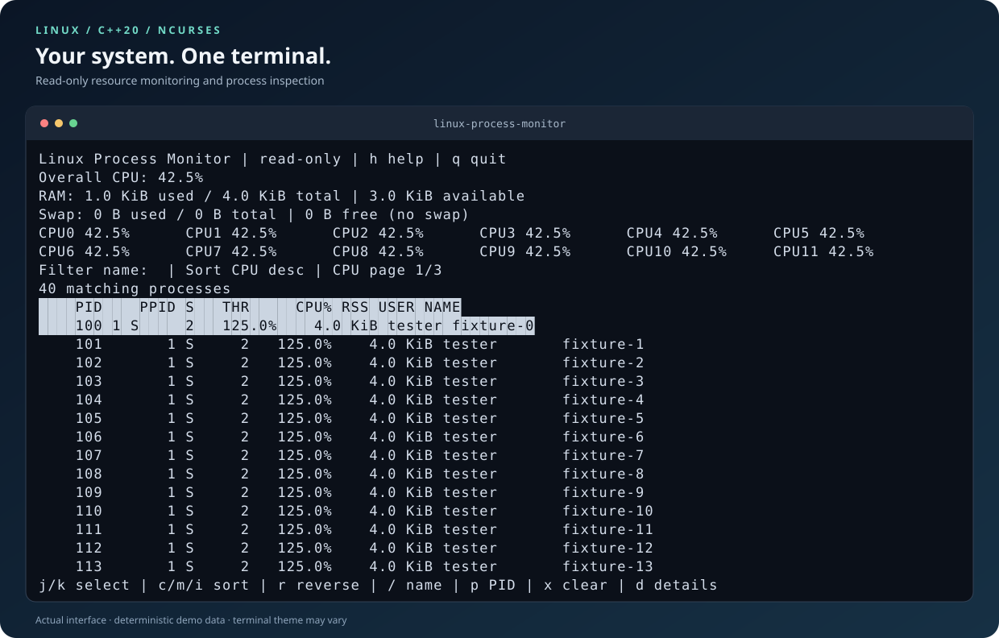
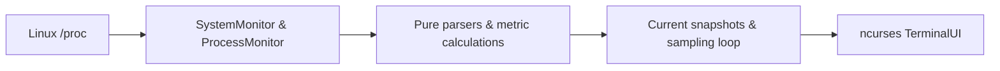

<div align="center">

# Linux Process Monitor

**Your system. One terminal.**

A lightweight C++20 process monitor inspired by `top` and `htop`.  
Live Linux metrics, keyboard-first inspection, and a focused ncurses interface.


[Quick start](#quick-start) · [Controls](#keyboard-controls) · [Architecture](#architecture) · [Testing](#testing) · [Documentation](#documentation)

</div>



<p align="center"><sub>Captured from the actual ncurses interface using deterministic demo data. Terminal colors depend on your theme.</sub></p>

## At a glance

| Monitor | Inspect | Navigate |
| --- | --- | --- |
| Overall and per-core CPU | PID, PPID, state, user, and threads | Sort by CPU, RSS, or PID |
| RAM and swap statistics | Process CPU% and resident memory | Search names or match an exact PID |
| Approximately one-second refresh | Full available command line and start time | Scroll, resize, and open contextual help |

**Direct `/proc` reads · No root required · Single process · No background workers**

The application is read-only. It never launches commands, terminates processes, or changes system configuration. New, inaccessible, and disappearing processes are handled explicitly, with identity tracking to prevent stale data after PID reuse.

## Quick start

### Requirements

- Linux with `/proc` mounted.
- A C++20-capable compiler and CMake **3.20+**.
- ncurses development headers and libraries.
- An interactive terminal of at least **80 × 24**, with a valid `TERM`.
- Python 3 only if you want the optional terminal integration tests.

On Debian/Ubuntu, the development packages are `g++`, `cmake`, and `libncurses-dev`. Supply these through your usual development-environment setup, then run the application and tests as an ordinary user.

### Build → test → run

From the repository root:

```sh
cmake -S . -B build
cmake --build build
ctest --test-dir build --output-on-failure
./build/linux-process-monitor
```

> **First launch:** CPU values start as `pending`. They become available after the next valid sample. Press `h` for help and `q` to quit outside the filter editor.

<details>
<summary><strong>Optimized Release build</strong></summary>

```sh
cmake -S . -B build-release -DCMAKE_BUILD_TYPE=Release
cmake --build build-release
ctest --test-dir build-release --output-on-failure
./build-release/linux-process-monitor
```

</details>

<details>
<summary><strong>Build environment and local ncurses troubleshooting</strong></summary>

Validated on Ubuntu 26.04, kernel 7.0.0-43-generic, GCC 15.2, CMake 4.2.3, and ncurses 6.6. Other C++20-capable Linux toolchains have not been verified here.

This workspace initially lackedncurses development headers. For verification, the matching `libncurses-dev` package was downloaded and extracted without installation into `/tmp/linux-monitor-deps/prefix`. Existing build caches use these overrides:

```sh
cmake -S . -B build \
  -DCURSES_INCLUDE_PATH=/tmp/linux-monitor-deps/prefix/usr/include \
  -DCURSES_LIBRARY=/usr/lib/x86_64-linux-gnu/libncurses.so.6 \
  -DCURSES_EXTRA_LIBRARY=/usr/lib/x86_64-linux-gnu/libtinfo.so.6
```

These paths are environment-specific and temporary. A normal installation of the development package needs no overrides; a fresh machine must supply its own headers/libraries. No dependencies or generated build files are committed.

</details>

## Keyboard controls

| Key | Action |
| --- | --- |
| Up/Down or `k`/`j` | Select a process; scroll when viewing details |
| Page Up/Page Down | Move through the table or details |
| `c`, `m`, `i` | Sort by CPU%, RSS, or PID |
| `r` | Reverse sort direction |
| `/` | Edit a case-insensitive name-substring filter |
| `p` | Edit an exact numeric PID filter |
| Enter/Esc while editing | Finish editing; keep the current query |
| Backspace while editing | Remove a query character |
| `x` | Clear the filter |
| `d` or Enter | Toggle selected-process details |
| Esc | Close details/help |
| `[` / `]` | Previous/next logical CPU page |
| `h` or `?` | Toggle help |
| `q` | Quit outside the filter editor |

Input and monitoring continue during filter editing. A hidden or exited selection is cleared; use navigation to explicitly select another process. Unavailable sort values always appear last, and equal values use ascending PID as a tie-breaker. Details preserve argument boundaries using quotes and allow scrolling through the entire available command line. Non-ASCII/control bytes are escaped rather than interpreted by the terminal.

## Architecture



| Component | Responsibility |
| --- | --- |
| `SystemMonitor` | CPU, RAM, swap, and system sampling baselines |
| `ProcessMonitor` | Enumeration, identity checks, CPU history, users, and details |
| `monitor_core` | Parsers, calculations, view logic, and testable helpers; no ncurses dependency |
| `TerminalUI` | Rendering, keyboard input, filters, selection, and terminal lifetime |
| Application loop | Monotonic sampling deadlines and current snapshots |

RAII owns descriptors and terminal resources. Sampling stays single-threaded, and retained state is limited to current processes, previous baselines, and selected details. See the [architecture document](ARCHITECTURE.md) for interfaces and tradeoffs.

## Metrics you can explain

<details>
<summary><strong>CPU, memory, process identity, and start-time definitions</strong></summary>

- **System/core CPU:** Counter differences from `/proc/stat`. Total includes user, nice, system, idle, I/O-wait, IRQ, softIRQ, and steal. Usage is `100 × (delta(total) - delta(idle + iowait)) / delta(total)`. Guest fields are already included in user/nice and are not added again.
- **Process CPU:** `100 × delta(utime + stime) / (CLK_TCK × actual elapsed seconds)`. Each process is timestamped near its read using a monotonic clock. One fully utilized logical CPU is 100%; multithreaded processes may exceed 100%. Child-process times are excluded.
- **Memory:** `/proc/meminfo` kB values are converted with 1024 bytes per unit. RAM used is total minus available; swap used is total minus free. Zero swap is valid.
- **RSS:** `/proc/[pid]/stat` resident pages multiplied by `sysconf(_SC_PAGESIZE)`. This is resident memory, not unique/private memory.
- **Identity:** PID plus start ticks. CPU baselines, selection, and details never intentionally carry across reused identities.
- **Start time:** `/proc/stat` boot epoch plus start ticks divided by `sysconf(_SC_CLK_TCK)`, displayed in the local time zone. If boot time is unavailable, realtime minus `/proc/uptime` provides an explicitly approximate fallback.
- **User:** Effective UID from `/proc/[pid]/status`, resolved through `getpwuid_r`; unresolved IDs are shown numerically.

First/new/recovered CPU samples are **pending**. Invalid deltas, missing sources, and inaccessible fields are **n/a/unavailable**, never fabricated zeroes. Counter regressions reset baselines. Detected suspend/realtime discontinuities exceeding two seconds also reset rate baselines. Slow scans skip missed deadlines rather than performing catch-up bursts.

</details>

## Testing

| Suite | Coverage |
| --- | --- |
| `core` | Deterministic parsing, calculations, identity, recovery, selection, formatting, and scheduling |
| `live` | Core checks plus Linux sampling, source comparisons, self-process discovery, and controlled CPU load |
| `terminal` | Optional Python-backed PTY checks: navigation, filters, details, resizing, refresh, process exits, and terminal restoration |

```sh
# All available suites
ctest --test-dir build --output-on-failure

# Deterministic checks only
ctest --test-dir build -R '^core$' --output-on-failure

# Sustained monitoring under process churn
python3 tests/soak_test.py build/linux-process-monitor 60
```

Tests run without root. Permission-error fixtures use temporary directories; only test harnesses launch disposable workloads.

**Recorded local verification** — these are completed validation results, not a live CI status:

- **117** deterministic checks; **126** checks including live sampling.
- All three CTest suites passed in default, Release, and **ASan/UBSan** builds.
- A **60-second** churn run created **289** short-lived processes: RSS remained **5,832 KiB** after warm-up, with **3–6** transient descriptors and no accumulation.
- Quit, SIGINT, and SIGTERM restored terminal attributes in PTY checks.

Detailed evidence is in [TASKS.md](TASKS.md). The finite-duration resource check describes the tested workload, not an indefinite memory guarantee.

## Documentation

| Document | Purpose |
| --- | --- |
| [PRD.md](PRD.md) | Approved product requirements and scope |
| [ARCHITECTURE.md](ARCHITECTURE.md) | Modules, sources, ownership, and design decisions |
| [IMPLEMENTATION_PLAN.md](IMPLEMENTATION_PLAN.md) | The 11-milestone development roadmap |
| [TASKS.md](TASKS.md) | Verified implementation progress and acceptance evidence |
| [AGENTS.md](AGENTS.md) | Repository engineering guidelines |

## Scope and limitations

- `/proc` snapshots are not atomic. A process may exit or change fields during collection; directory-relative reads and identity revalidation prevent stale PID associations but do not freeze process state.
- Restricted `/proc` mounts can hide processes entirely. Values reflect the current namespace/kernel view, not container CPU/memory quotas.
- Sampling and user lookup are synchronous. Slow filesystem or NSS operations can delay refresh/input; the program makes no hard real-time guarantee.
- Kernel process names may already be truncated; the available full command line is shown separately. Command-line data may be empty, restricted, or changed by the process itself.
- UID mappings are cached while that UID remains present. Local account-name changes may require restarting the monitor to appear.
- All logical cores are accessible through CPU pages; very large process counts and exceptionally large command lines increase memory and rendering work proportionally.
- Terminal cleanup cannot be guaranteed after SIGKILL, power loss, or fatal system failure.

File management, arbitrary command execution, IPC workers, network/service/user management, process termination, web interfaces, and kernel modules remain out of scope.

---

<p align="center"><sub>Built to explore modern C++, Linux internals, and careful systems engineering.</sub></p>
